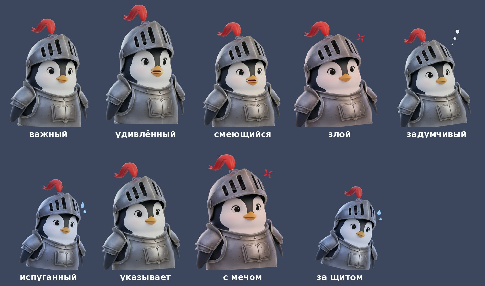

# Хроники сэра Лата

Канал с видеопересказами и обзорами манхвы. Ведущий — **сэр Пингвин Лат**,
пингвин-рыцарь в железном шлеме с забралом. Персонаж оригинальный: основа — авторская
картинка, а вся анимация (клюв, моргание, покачивание, эмоции) делается кодом поверх неё.



Схема работы:

```
notes/*.txt ─► Gemini (сценарий от лица сэра Лата, с метками эмоций)
            ─► edge-tts (голос + тайминги каждого слова)
            ─► кадры: нарисованная кодом сцена + сэр Лат + субтитры
            ─► ffmpeg ─► готовое видео
```

## Быстрый старт через GitHub Actions

1. **Добавьте секрет.** Откройте в репозитории *Settings → Secrets and variables → Actions → New repository secret*
   и создайте секрет `GEMINI_API_KEY` — ключ из [Google AI Studio](https://aistudio.google.com/apikey).
   (Секрет `PIXABAY_API_KEY`, если он уже есть, больше не используется — его можно оставить.)
2. **Положите заметки.** Создайте в папке `notes/` текстовый файл, например `notes/glava-12-15.txt`,
   и напишите несколько строк своими словами: что произошло в главах и что вы об этом думаете.
   Образец — `notes/example.txt`.
3. **Запустите сборку.** Вкладка *Actions → «Сделать видео» → Run workflow*. Заполните поля:
   - `notes_file` — имя файла (`glava-12-15.txt`, можно без `.txt`) или путь (`notes/glava-12-15.txt`).
     Файл ищется во всех папках `notes/` репозитория; если имя встречается в нескольких, укажите путь;
   - `format` — `long` (16:9, 10–30 минут), `short` (9:16, до 59 секунд) или `both` (оба);
   - `minutes` — желаемая длина длинного видео (по умолчанию 14).
4. **Скачайте результат.** Когда сборка закончится, откройте запуск и внизу, в блоке *Artifacts*,
   скачайте архив `sir-lat-…`. Внутри видео (`*_long.mp4`, `*_short.mp4`) и сценарии (`script_*.txt`).

Длинное видео собирается примерно за 1,5–3 минуты работы на минуту видео.

Модели Gemini перебираются по очереди, пока одна не ответит: `gemini-flash-latest`,
`gemini-flash-lite-latest`, `gemini-2.0-flash`. В логе сборки видно, какая сработала
(«Gemini: сработала модель …»). Чтобы первой пробовалась другая модель, задайте переменную
репозитория `GEMINI_MODEL` (*Settings → Secrets and variables → Actions → Variables*).

## Свои фоны

Загрузите картинки в папку `backgrounds/` (png, jpg, webp): вертикальные 9:16 — для шортсов,
горизонтальные 16:9 — для длинного видео. Если нужной ориентации нет, берутся другие картинки
с обрезкой по кадру.

- **Выбор по смыслу — через имя файла.** Слова имени сравниваются со словами фразы и с типом
  сцены: `forest_campfire.png` подойдёт к «у костра в лесу», `dungeon.png` — к «спустился
  в подземелье», `tavern.jpg` — к «торговка в таверне». Можно называть по-русски:
  `лес_костёр.png`. Понятные английские слова: forest, campfire, dungeon, cave, mine, tavern,
  inn, city, town, castle, village, market, system, window, level, hero, knight, sword, battle,
  monster, shadow, boss, goblin, dragon, night, mountain, prison, temple и другие.
- Если подходящей картинки нет, остаётся прежний фон; в начале видео берётся любая картинка.
- **Движение:** медленный зум и панорама плюс параллакс — нижняя часть картинки (ближний план)
  смещается сильнее верхней (дальний план).
- Если в `backgrounds/` нет картинок, используются сцены, нарисованные кодом.

## Автогенерация фонов

Если для сцены нет подходящей вашей картинки, фон создаётся автоматически:

1. Сценарий делится на сцены (подряд идущие фразы об одном месте).
2. Gemini описывает каждое место на английском — без людей и персонажей — и даёт теги.
3. Картинку рисует **Pollinations.ai** (бесплатно, без ключа), а если он не ответил —
   **Hugging Face FLUX.1-schnell** (нужен секрет `HF_TOKEN`, необязательно).
4. Ко всем описаниям добавляется единый стиль: *Empty location, NO people, NO characters.
   Low-poly 3D animation style, matte materials, visible flat facets, soft cinematic lighting.
   No text, logos or watermarks.* Формат — 9:16 для шортса и 16:9 для длинного видео.
5. Фон сохраняется в `backgrounds/generated/` с именем из тегов (например
   `dungeon_torch_corridor_40bb81_9x16.jpg`) и описанием в `index.json`. Для похожей сцены
   (тот же тип места и общие теги) берётся готовый фон. На GitHub Actions папка сохраняется
   между запусками (кэш) и кладётся в artifact — понравившиеся фоны можно перенести
   в `backgrounds/`.

Ваши картинки из `backgrounds/` всегда в приоритете: сгенерированные используются, только когда
ни одна ваша не подходит по смыслу. Ограничения бесплатного Pollinations: одна картинка примерно
в 45 секунд и до 1024 пикселей по длинной стороне (в кадре картинка аккуратно увеличивается),
поэтому новых фонов за запуск не больше 6 для шортса и 12 для длинного видео (переменная
`BG_GEN_MAX`); остальные сцены берут уже готовые фоны. Знак «pollinations.ai», который
бесплатный сервис ставит в углу, срезается. Отключить генерацию: `--no-bg-gen` или переменная
`SIRLAT_BG_GEN=0`.

## Своим голосом

Можно озвучить сэра Лата своим голосом, записанным на телефон:

1. Запишите выпуск (m4a, mp3, wav, ogg…) и загрузите в папку `voice/` с тем же именем, что
   у файла заметок: для `notes/goblin_ch1.txt` — `voice/goblin_ch1.m4a`. Расширение любое,
   регистр не важен, ищется во всех папках `voice/`. Через сайт GitHub можно загрузить файл
   до 25 МБ. В логе сборки видно все файлы папок `voice/` и какой взят.
   Если запись с таким именем есть, но пустая или не читается, сборка остановится с ошибкой
   (а не озвучит синтезом) — загрузите файл заново.
2. Запустите «Сделать видео» как обычно. Если запись найдена, видео делается по ней, без синтеза
   речи: сценарий и субтитры берутся из распознанного текста (faster-whisper).
3. В artifact, кроме видео, будет почищенный голос `…_golos_chistyj.mp3` — его можно послушать
   отдельно.

Что делается с записью:

- **чистка:** шумоподавление, срез гула и шипения; вырезаются слова-паразиты («э», «эм», «ну»,
  «короче», «типа», «как бы»), повторы («он ничего не помнит, ничего не помнит»), оборванные слова
  и всё нераспознанное между словами; паузы длиннее 0,4 с убираются (по ним фразы делятся
  для субтитров);
- **звук под персонажа:** тёплый эквалайзер, компрессор, громкость −14 LUFS; высоту голоса
  можно сдвинуть переменной репозитория `VOICE_PITCH` в полутонах (по умолчанию `0`,
  например `2` — чуть выше);
- **эмоции сэра Лата** расставляются по смыслу фраз (Gemini; без ключа — по ключевым словам),
  фон — нарисованные сцены по смыслу, как и в обычном режиме.

Распознавание — модель `medium` (точнее, но медленнее: примерно минута-две на минуту записи
на GitHub Actions). Сменить можно переменной `WHISPER_MODEL` (`small` — быстрее). Если запись
пустая или не читается, сборка останавливается с понятной ошибкой.
Локально: `--no-voice` — игнорировать запись.

## Пробы голоса

Workflow *Actions → «Пробы голоса» → Run workflow* озвучивает одну фразу (её можно поменять
в поле `text`) голосами Silero `aidar`, Silero `eugene` и edge-tts `ru-RU-DmitryNeural`, каждым
в трёх вариантах:

| Файл | Подача |
|---|---|
| `…_obychny.mp3` | обычный голос |
| `…_vyshe.mp3` | чуть выше и быстрее: +2,5 полутона, темп +10% |
| `…_energichno.mp3` | заметно выше и энергичнее: +4,5 полутона, темп +18% |

Например, `aidar_vyshe.mp3`. Громкость всех проб выровнена. Все файлы и отчёт `otchet.txt`
лежат в одном artifact `proby-golosa-…`. Если edge-tts не даёт звук со сдвигом высоты,
обычная запись Дмитрия сдвигается через ffmpeg — это отмечено в отчёте.

Локально: `python -m sirlat.voice_samples` (результат в `voice_samples/`).

## Запуск на своём компьютере

Нужны Python 3.10+, ffmpeg и шрифт с кириллицей (DejaVu).

```bash
pip install -r requirements.txt
```

```bash
export GEMINI_API_KEY=ваш_ключ
```

```bash
python -m sirlat --notes notes/example.txt --format both
```

Результат появится в `output/<имя файла заметок>/`.

Полезные флаги:

| Флаг | Что делает |
|---|---|
| `--format long/short/both` | какой формат собирать |
| `--minutes 20` | целевая длина длинного видео (10–30 минут) |
| `--script файл.txt` | собрать видео по готовому (например, отредактированному) сценарию, без Gemini |
| `--reuse-script` | взять сценарий из прошлого запуска в `output/` |
| `--preview 30` | собрать только первые 30 секунд, чтобы быстро проверить картинку |
| `--offline` | без интернета и ключей: тестовый сценарий и синтетический «голос» (для проверки сборки) |
| `--keep-parts` | не удалять промежуточные части длинного видео |

## Сценарий и разметка

Gemini пишет сценарий от лица сэра Лата: короткие фразы, юмор, личные оценки
(«семь рыбок из десяти»). События пересказываются своими словами, без дословных цитат из оригинала.
Сценарий сохраняется в `output/…/script_long.txt`: его можно поправить руками и собрать заново
с `--script`.

```
# Название выпуска
## Часть 1: Вступление
{сцена: таверна}              фон: подземелье, пещера, таверна, город, лес, окно, герой, монстр
{окно: Получено задание: досмотреть до конца}   «системное окно» на следующей фразе
[важный] Приветствую, благородные зрители!
[удивлённый, меч] Эмоция и, если нужно, поза через запятую.
```

- Эмоции: `важный`, `удивлённый`, `смеющийся`, `злой`, `задумчивый`, `испуганный`.
- Позы: `указывает` (крылом), `меч`, `щит` (прячется за щитом).

## Что в кадре

- **Фон** — ваши картинки из `backgrounds/` (см. «Свои фоны»), а если их нет — сцены, нарисованные кодом в едином мультяшном стиле: подземелье, пещера,
  таверна, город, лес, игровое окно, безликий силуэт героя и тень монстра. Никаких фото,
  реальных мест, людей и стоковых съёмок. Сцена выбирается для каждой фразы по смыслу:
  метка `{сцена: …}` прямо перед фразой, иначе слова фразы («таверна», «пещера», «тень»,
  «окно системы»…), иначе остаётся прежняя сцена. Слишком короткие смены сцены
  не делаются, чтобы фон не мельтешил. В кадре всё время лёгкое движение: медленный зум
  и панорама, параллакс переднего плана (колонны, стволы, стойка), мерцание факелов,
  очага и фонарей, «дышащие» кристаллы, частицы (искры, пыль, светлячки, блёстки).
- **Сэр Лат** стоит слева по пояс (в шортсе — в левом нижнем углу, в длинном видео — у левого края) и не заходит на субтитры: в длинном видео они правее него, в шортсе — над ним. Он меняет эмоции по разметке,
  открывает клюв в такт громкости голоса, моргает и слегка покачивается.
- **Голос:** основной — Silero TTS (`v4_ru`, голос `eugene`, запасной `aidar`), чуть ниже и медленнее;
  если Silero не сработал — edge-tts `ru-RU-DmitryNeural` (с повторами и упрощёнными параметрами),
  затем gTTS. Ошибка одного голоса не роняет сборку. Каждая фраза озвучивается отдельно, между
  фразами паузы. В логе видно, какой голос сработал («TTS: озвучиваю движком …»). Порядок можно
  поменять переменной `SIRLAT_TTS` (например, `edge,silero,gtts`). Модели Silero распространяются
  по лицензии CC BY-NC (некоммерческое использование).
- **Субтитры** идут по словам: текущее слово подсвечивается. Время слов даёт edge-tts (WordBoundary),
  а для Silero и gTTS — распознавание речи faster-whisper.
- **Длинное видео** 1920×1080 собирается по частям сценария, затем части склеиваются.
  **Шортс** 1080×1920 — отдельный тизер. Если озвучка выходит длиннее 59 секунд, лишние фразы
  убираются, а финальный призыв остаётся.

## Персонаж

Основа — картинка `assets/sir_lat/source/sir_lat_original.jpg`. Из неё скрипт подготовки
делает `assets/sir_lat/sir_lat.png`: удаляет фон (rembg), обрезает по пояс и находит клюв
и глаза (`assets/sir_lat/landmarks.json`).

Анимация поверх картинки (все параметры меняются плавно, эмоции сменяются за ~0,25 с):

- **клюв** — открывается плавно, по громкости голоса; форма зависит от гласной: «а» — широко,
  «о/у» — узко и округло, «и/е» — плоско и широко;
- **глаза** — моргают в случайные моменты (иногда дважды, часто при смене эмоции), смотрят
  в сторону экрана и по сторонам; прищур у важного и злого, «улыбчивые» глаза у смеющегося,
  широко раскрытые при удивлении и страхе, наклон век — хмурится или волнуется;
- **шлем** — забрало поднимается от удивления и опускается, когда сэр Лат злится;
- **тело** — дыхание, лёгкие кивки в такт речи, наклон вперёд на важных фразах (с «!»),
  подпрыгивание, когда смеётся, дрожь от страха;
- **крылья** — короткие взмахи на ударных словах (громкие, с «!», длинные или «сильные» слова);
  в позе `указывает` крыло поднято, `меч` — гордо выпрямился, `щит` — прижал крылья;
- **значки** — капли пота, «венка» злости, пузырьки мыслей — проявляются и гаснут вместе с эмоцией.

Готовые кадры в `assets/sir_lat/` (PNG с прозрачным фоном): `emotion_*.png`, `pose_*.png`,
`anim/mouth_*.png` (формы клюва), `anim/blink.png`, `anim/look_left.png`, общий лист — `preview_sheet.jpg`.

**Заменить картинку персонажа:**

1. Положите новую картинку в `assets/sir_lat/source/` (старую уберите).
2. Подготовьте её (нужно один раз, на своём компьютере; rembg скачает модель ~180 МБ):

```bash
pip install -r requirements-character.txt
```

```bash
python -m sirlat.prepare_character --waist 0.84
```

   `--waist` — где резать «по пояс», доля высоты фигуры от макушки.
3. Пересоберите кадры эмоций и проверьте `preview_sheet.jpg`:

```bash
python -m sirlat.character
```

4. Закоммитьте `assets/sir_lat/`. Если клюв или глаза найдены неточно, поправьте координаты
   в `landmarks.json` вручную.

## Структура проекта

```
sirlat/
  prepare_character.py  удаление фона, обрезка по пояс, поиск клюва и глаз
  character.py   анимация сэра Лата: эмоции, позы, клюв, моргание
  bg_gen.py      автогенерация фонов: описание Gemini → Pollinations / FLUX.1-schnell
  backgrounds.py свои фоны из backgrounds/: выбор по имени файла, зум и параллакс
  own_voice.py   своя запись голоса: поиск, чистка, распознавание, обработка
  scenes.py      сцены, нарисованные кодом: слои, свет, частицы, камера; выбор сцены по смыслу
  script.py      промпт для Gemini и разбор разметки
  tts.py         edge-tts, тайминги слов, громкость для клюва
  render.py      сборка кадров и частей видео через ffmpeg
  __main__.py    командная строка
notes/           ваши заметки по главам
assets/sir_lat/  картинка персонажа, исходник и кадры эмоций
.github/workflows/make-video.yml   ручной запуск сборки
```

Загрузки на YouTube пока нет: видео сохраняется как artifact сборки.
